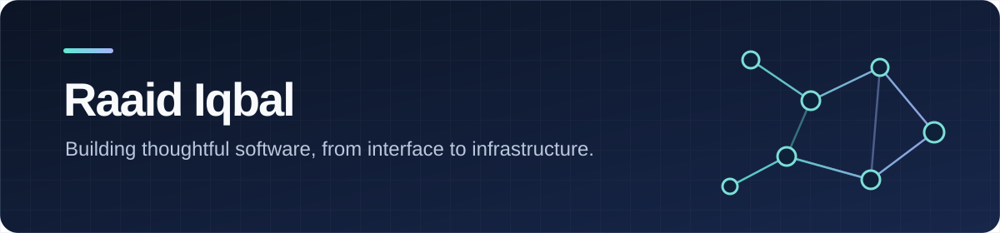

  

   

  <a href="https://raaid.iqbalm490714.chatgpt.site/"><strong>Visit my portfolio</strong></a>
  &nbsp;·&nbsp;
  <a href="https://github.com/raaidiqbal?tab=repositories"><strong>Explore my projects</strong></a>
  &nbsp;·&nbsp;
  <a href="https://seonsu.iqbalm-963.workers.dev/"><strong>Try the Seonsu demo</strong></a>

## About me

I'm Raaid, a developer interested in the whole path from a useful idea to a working product. I enjoy building clear interfaces, dependable backend systems, and understanding the networks that connect them.

Right now, I'm building **[Seonsu](https://github.com/raaidiqbal/Seonsu)**, a return-to-sport recovery prototype with a React and TypeScript interface, versioned progression rules, and a Cloudflare D1 backend. [Try the live demo](https://seonsu.iqbalm-963.workers.dev/).

## Selected work

| Project | What it does | Built with |
| :--- | :--- | :--- |
| **[Seonsu](https://github.com/raaidiqbal/Seonsu)** · [Live demo](https://seonsu.iqbalm-963.workers.dev/) | Tracks a focused recovery pathway with check-ins, exercise completion, and rule-based progression. | TypeScript, React, Cloudflare Workers, D1 |
| **[Faultline](https://github.com/raaidiqbal/faultline-dbx)** · [Incident console](https://github.com/raaidiqbal/faultline-dbx/blob/main/docs/faultline-dashboard.png) | Tests whether duplicate, late, malformed, out-of-order, and deleted events still converge to a provably correct lakehouse state. | Python, Databricks, Lakeflow, Delta Lake |
| **[NextEpisode](https://github.com/raaidiqbal/NextEpisode)** · [Live demo](https://next-episode-raaid.iqbalm-963.workers.dev/) · [Demo videos](https://github.com/raaidiqbal/NextEpisode/tree/master/Feature%20Demos) | A team-built anime discovery site with search, genre filters, rankings, and a random pick feature. | Python, Flask, HTML, CSS |
| **[Wardrobe Studio](https://github.com/raaidiqbal/wardrobe-studio)** | An interactive digital wardrobe where garments rotate from a clothing rack into a focused detail view. | JavaScript, HTML, CSS, Python asset pipeline |

## What I work with

`TypeScript` &nbsp; `JavaScript` &nbsp; `React` &nbsp; `Python` &nbsp; `Flask` &nbsp; `SQL` &nbsp; `Databricks` &nbsp; `Cloudflare Workers`

  Thanks for visiting — explore the repositories above to see the work behind each project.

